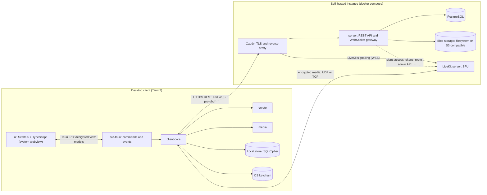
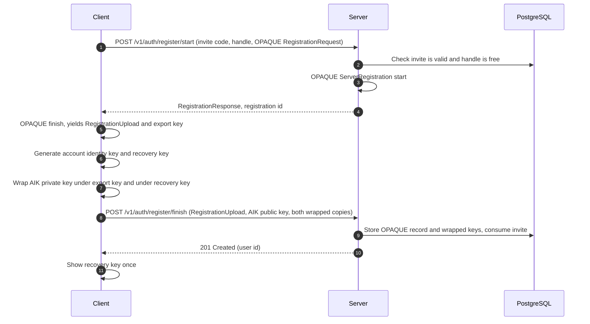
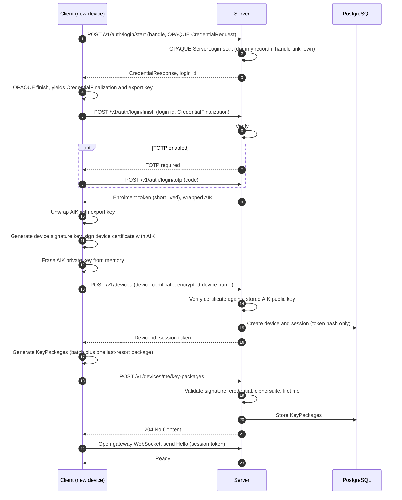
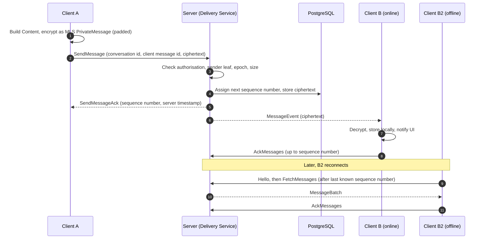
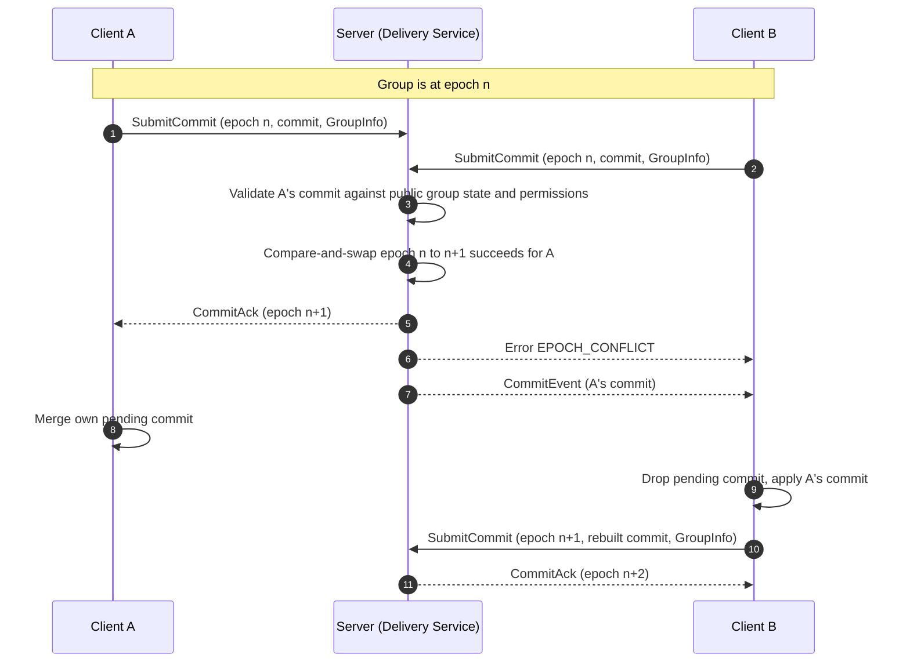
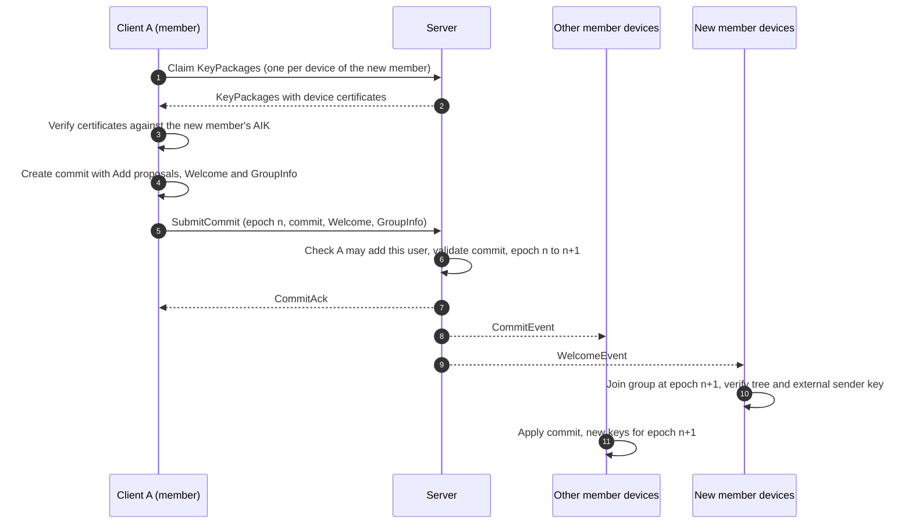
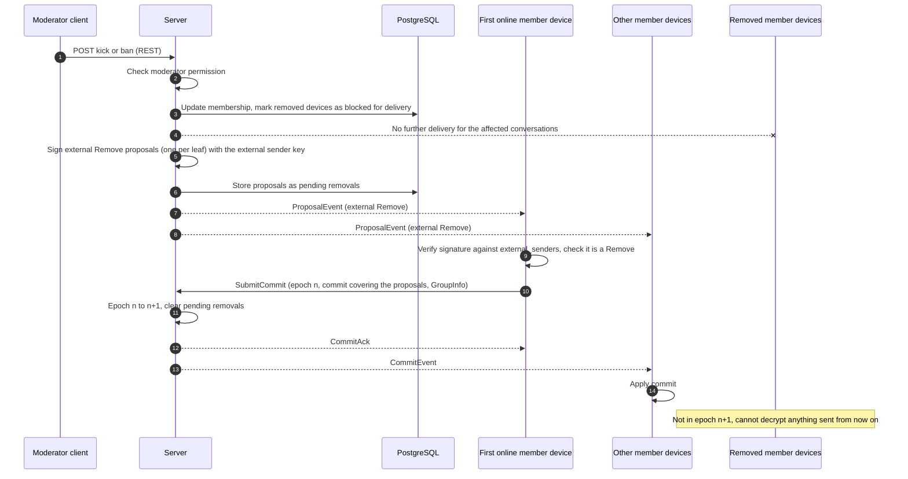
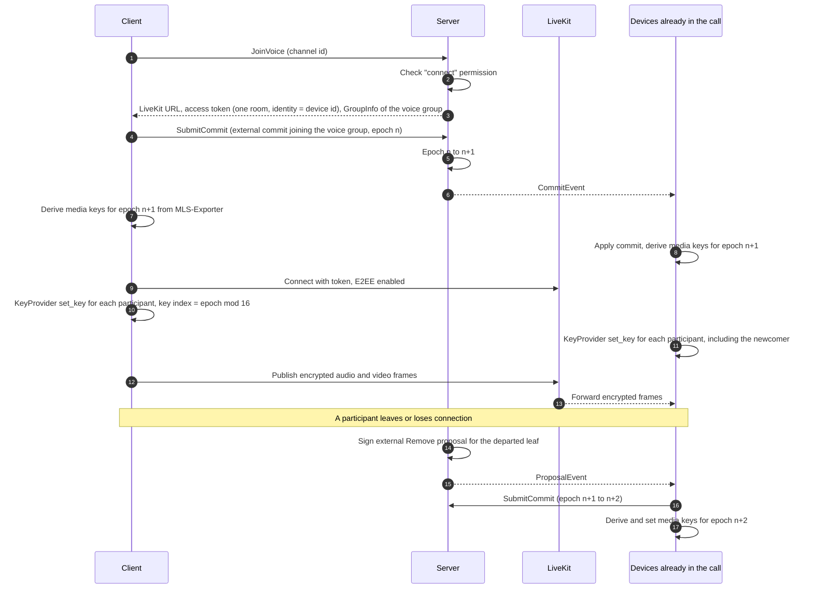
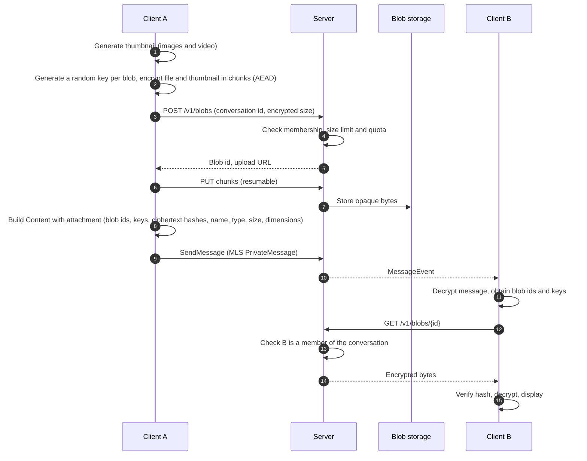

# Architecture

This document describes the components of Tavern, what each crate is responsible for, and the main flows. Decisions are recorded in [`docs/adr/`](adr/); what the server can and cannot see is detailed in the [threat model](threat-model.md); wire formats are in the [protocol specification](protocol.md); the server tables are in the [database schema](database-schema.md).

Status: design. Nothing described here is implemented yet.

## 1. Components

The server never receives plaintext content or keys. The UI never receives keys or ciphertext.

### Network endpoints of an instance

| Endpoint | Default port | Served by |
|---|---|---|
| REST API, gateway WebSocket | 443/TCP | Caddy → `server` |
| LiveKit signalling | 443/TCP (separate host name) | Caddy → LiveKit |
| Media (ICE over UDP, multiplexed) | one UDP port | LiveKit |
| Media fallback (ICE over TCP) | 7881/TCP | LiveKit |
| TURN over TLS (optional, disabled by default) | 5349/TCP | LiveKit |

Using a single multiplexed UDP port keeps port forwarding simple on a home router and works with Docker's bridge network. Host networking with a UDP port range is an advanced option on Linux. Exact values and the port forwarding guide are in `docs/self-hosting.md` (written in M0).

## 2. Crates

| Crate | Responsibility | Internal dependencies |
|---|---|---|
| `protocol` | `.proto` files and generated types for the gateway and for message content, REST DTOs, error codes, size limits, protocol version constants. No I/O. | none |
| `crypto` | Wrapper around OpenMLS (group lifecycle, credentials, device certificates, KeyPackages, exporter), OPAQUE client and server helpers, account identity key handling, media key derivation, attachment encryption, public group state validation used by the server. | `protocol`, `argon2-memory` |
| `argon2-memory` | Working memory for Argon2id in a dedicated mapping, erased and returned to the system on drop. The only crate of the project with `unsafe` code of its own (ADR 0015). | none |
| `server` | Binary. REST API (axum, OpenAPI), WebSocket gateway, authentication, sessions, invitations, permissions, Delivery Service (ordering, storage and fan-out of MLS messages), KeyPackage directory, blob storage backends, LiveKit token issuance, migrations. | `protocol`, `crypto` (validation only, never decryption) |
| `media` | Screen, window, camera and audio capture per OS, system audio capture, encoder selection, noise suppression. Built on `libwebrtc` types so that frames flow to LiveKit without copies. | none |
| `client-core` | All client logic without UI: instance connection, authentication, gateway session, MLS state machine, local encrypted store, sync, LiveKit rooms and E2EE key provisioning, attachments, local search, state exposed to the shell. | `protocol`, `crypto`, `media` |
| `apps/desktop/src-tauri` | Tauri shell: windows, tray, commands and events mapped one-to-one onto `client-core`. No business logic. | `client-core` |
| `apps/desktop/ui` | Svelte UI. Renders view models, sends user intents. | — |

`#![forbid(unsafe_code)]` applies to `protocol`, `crypto` and `server`. The project's own `unsafe` code is confined to `argon2-memory`, which is tested under Miri.

### Client-side storage

- A SQLCipher database (through `rusqlite`) holds MLS group state, decrypted message history, the search index, contacts and settings.
- The database key is random, generated at first launch and kept in the OS keychain (`keyring`).
- The session token and the device signature key live in that database. The account identity key is **not** stored on devices (see section 3.2).

### Identity model

| Object | Key | Where the private part lives |
|---|---|---|
| Account | Ed25519 account identity key (AIK) | Wrapped copies on the server (password-derived key, recovery key). In client memory only while certifying a device. |
| Device | Ed25519 MLS signature key | Device local store |
| Device certificate | AIK signature over (user id, device id, device signature key) | Public; carried in the MLS credential |
| Instance | Dedicated Ed25519 MLS external sender key | Server secret, backed up with the instance |

Safety numbers shown to users are derived from the two AIK public keys. Clients pin the AIK of every contact on first use and warn on change.

## 3. Flows

In the diagrams, **Client** means `client-core` on one device and **Server** means the `server` binary behind Caddy.

### 3.1 Registration (OPAQUE)

The password never leaves the client. The invitation code is consumed only when registration completes.

### 3.2 Login, device registration and KeyPackage publication

A device that already has a session skips to the last two steps. The new device then joins each of the user's conversations with an MLS external commit (section 3.5); it has no earlier history ([ADR 0006](adr/0006-no-prior-history-v1.md)), which the UI explains at enrolment and at the top of each conversation. History transfer is planned in [ADR 0009](adr/0009-history-on-new-devices.md).

At registration and password change the client enforces a minimum password strength locally (length and a zxcvbn-style estimate), because the password also protects the account identity key.

### 3.3 Sending a message

The flow is the same for a DM, a private group and a server channel. Only the authorisation check differs:

| Conversation | The server accepts the message if |
|---|---|
| DM | the sender is one of the two participants and neither has blocked the other |
| Private group | the sender is a current member |
| Text channel | the sender's roles grant "send messages" on the channel |

In every case the sending device must be a leaf of the group and the message epoch must be the group's current epoch.

The server sees the conversation id, the sending device, the time and the padded size. Edits, deletions, replies, reactions and attachments are application messages like any other; the server cannot tell them apart.

### 3.4 Commit ordering

MLS requires all members to apply the same sequence of commits. The server accepts exactly one commit per epoch with an atomic compare-and-swap on the group's epoch.

Handshake messages travel as MLS `PublicMessage`, so the server can check that the proposals in a commit match what the sender is allowed to do and can keep the public ratchet tree up to date. An application message encrypted for an epoch that has just been superseded is rejected with `STALE_EPOCH`; the client applies the pending commit and re-encrypts.

### 3.5 Adding a member, adding a device

A **new device of an existing member** does not wait for someone to add it. It fetches the group's latest `GroupInfo` from the server and joins with an MLS external commit. Other members accept that commit only if the new leaf carries a device certificate signed by the AIK of a user who is already in the group.

Joining a server gives access to several channels at once. The planned mechanism is an external commit authorised by the server's roles, so the newcomer does not wait for a member to be online; the arrival is always displayed in the channel. A "private channel" option requires an Add committed by an existing member instead. The final decision is taken at M4 (see the threat model for what is at stake).

Each enrolment of a device is announced: the account's other devices receive `DeviceListChanged` and show a notification with a revoke action, and contacts see a notice in shared conversations.

### 3.6 Removing a member (kick, ban, role change, revoked device)

- Delivery stops as soon as the server records the removal. The cryptographic removal follows when the first member device commits; if the moderator's device is online that happens within one round trip.
- Every member device that receives the proposal tries to commit it after a short random delay. The compare-and-swap of section 3.4 keeps one commit and the others drop theirs.
- While removals are pending, the server refuses application messages for the conversation with `REMOVAL_PENDING`, so that nothing new is encrypted for the removed leaf. The client handles this by itself: it commits the pending proposals, re-encrypts the message for the new epoch and sends it again. The user sees a normal send, never an error.
- Clients reject external proposals of any other type. The server can ask for a removal; it can never ask for an addition.
- A removal from a server triggers the same sequence for every channel group the user was in. A ban also records the user id so that it cannot rejoin.
- The external sender key is a dedicated instance secret. Its loss or rotation is handled as described in [ADR 0002](adr/0002-mls-via-openmls.md#external-sender-key-lifecycle): members repair the group's `external_senders` list with an ordinary commit, and until then removals are committed by a member with the right permission.

### 3.7 Joining a voice channel

A voice channel has its own MLS group whose members are the devices currently connected. A call in a DM or private group uses that conversation's group.

- Media key for a participant at a given epoch: `MLS-Exporter("tavern media v1", participant identity, 32 bytes)`. Every member of the group can compute every participant's key; LiveKit and the server cannot.
- Receivers keep the previous epoch's key in the key ring for a few seconds so that frames in flight during a rotation still decrypt.
- LiveKit data packets are encrypted with the same key provider.
- The token is issued only after the permission check, expires quickly, and is valid for a single room. If a user loses the permission during a call, the server removes the participant through the LiveKit room API and triggers the removal flow.
- LiveKit signalling is protected by TLS, not end-to-end. LiveKit sees who is in the room and traffic volumes, never media content.

### 3.8 Sending an encrypted attachment

The server stores bytes it cannot read. File name, MIME type, dimensions and the key travel only inside the MLS message. The server knows the blob's size, uploader, conversation and time. The chunked AEAD construction and the exact cipher are fixed in an ADR at M5; custom emojis, including animated ones, use the same mechanism and are never visible to the server.

## 4. Media pipeline

- Capture: `libwebrtc::desktop_capturer` for screens and windows first; OS-specific capture only if M7 measurements require it. Camera and microphone through the `media` crate.
- Encoding: the encoders bundled with the LiveKit SDK (VideoToolbox on macOS, NVENC and VAAPI on Linux, NVENC on Windows), OpenH264 in software otherwise. H.264 by default; AV1 or VP9 when both ends have hardware support.
- Screen sharing defaults to 1080p60 at about 8 Mb/s, with a "sharp text" mode (resolution first) and a "smooth motion" mode (frame rate first). Simulcast serves viewers with weaker connections.
- Rendering of remote video (webview or native) is decided at M7.

See [ADR 0004](adr/0004-livekit-sfu-native-media.md).

## 5. Server internals

- One process: axum for REST and the WebSocket upgrade, tokio tasks per connection, an in-process registry of connected devices for fan-out. No Redis and no message broker; a single server instance is assumed.
- PostgreSQL through sqlx, migrations applied at start-up (can be disabled).
- Rate limiting in memory, per IP and per account.
- Blob storage behind a trait with two backends: local filesystem (default) and S3-compatible.
- Configuration through environment variables only; no hard-coded domain, address or secret.
- Instance secrets, each with a single purpose: OPAQUE server setup, MLS external sender key, LiveKit API key and secret, key for server-side encryption of TOTP secrets. All are generated by `deploy/scripts/init.sh` and covered by the backup scripts.
- `GET /health` and `GET /version` (version, supported protocol versions, external sender public key, source link).

## 6. Performance notes

| Budget (from `CLAUDE.md`) | Main levers |
|---|---|
| Client idle under 150 MB | System webview, virtualised message list, paged history, lazy loading of LiveKit |
| Client in voice call under 200 MB | Native media stack, no video surfaces when nobody shares |
| Client sharing 1080p60 under 300 MB | Hardware encoding, zero-copy frames where the capturer allows |
| Cold start under 2 s | Small UI bundle, local store opened before the network |
| Message latency under 100 ms on LAN | One WebSocket round trip, one indexed insert |
| Server for 40 users on 4 vCPU / 8 GB | Single process, no transcoding in the SFU |

Bandwidth is the limiting resource of an instance: one 1080p60 stream watched by ten people is about 80 Mb/s outbound.
